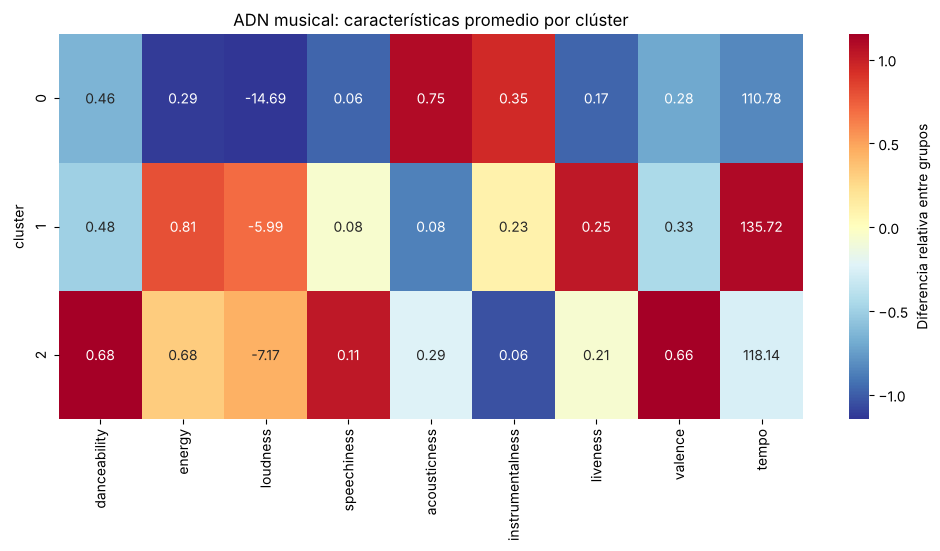
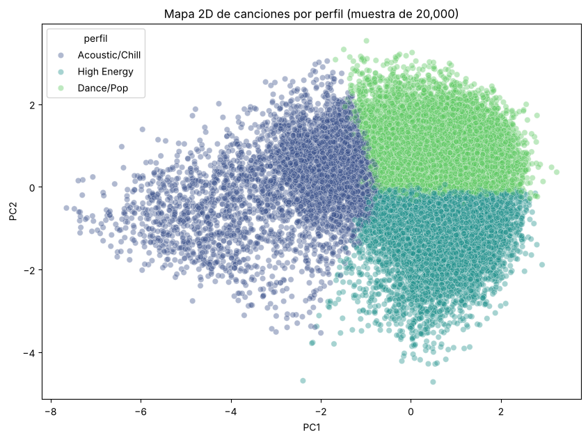
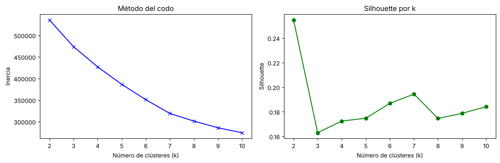

[README.md](https://github.com/user-attachments/files/33568865/README.md)
# 🎵 MusicDNA: Segmentación de Spotify y recomendador por similitud

**En una línea:** segmenté ~75,000 canciones únicas de Spotify en 3 perfiles sonoros a partir de su audio y construí un recomendador que sugiere las 5 canciones más parecidas a una elegida, sin usar etiquetas de género.

**Stack:** Python · pandas · scikit-learn · matplotlib · seaborn

---

## 🎯 Problema
Un catálogo musical grande se organiza normalmente con metadatos manuales (género, artista), que no describen *cómo suena* una canción. ¿Se puede agrupar y recomendar música usando solo sus características de audio?

## ✅ Resultados

| Perfil sonoro | Cómo suena | Rasgos clave |
|---|---|---|
| **High Energy** | Intensa, fuerte y rápida | energía 0.81 · volumen -5.99 dB · tempo 136 BPM |
| **Acoustic/Chill** | Suave, tranquila, acústica | acústica 0.75 · energía 0.29 · volumen -14.69 dB |
| **Dance/Pop** | Rítmica, positiva y con voz | bailabilidad 0.68 · positividad 0.66 · casi siempre con voz |

- **Datos:** ~75,000 canciones únicas tras limpieza (de ~114,000 registros originales).
- **Recomendador:** las 5 canciones sugeridas quedan, en promedio, **~96% más cerca** de la canción elegida (distancia coseno) que 5 canciones al azar del mismo grupo.
- **Honestidad sobre los límites:** los grupos **se solapan** (silhouette 0.163). Son zonas de mayor densidad, no categorías rígidas. Detalle en [Limitaciones](#-limitaciones).





## 🔧 Qué hice
1. **Carga y limpieza:** el archivo trae filas mal formadas, valores imposibles (por ejemplo `energy = 11`) y pistas sin análisis de audio; las descarté. Eliminé canciones repetidas (el dataset repite una misma canción en varios géneros).
2. **Escalado:** estandaricé las 9 variables de audio para que `tempo` o `loudness` no dominen el modelo.
3. **Elección de grupos:** probé k = 2 a 10 con método del codo y silhouette. Elegí **k = 3 por interpretabilidad**: k = 2 tiene mayor silhouette (0.255) pero separa en dos bloques poco útiles.
4. **Segmentación:** K-Means (k = 3) y perfilamiento automático de cada grupo.
5. **Visualización:** PCA a 2D (retiene 47.4% de la varianza; es una vista ilustrativa, no una prueba de separación).
6. **Recomendador:** dentro del grupo de la canción elegida, busco las más cercanas por **distancia coseno**.
7. **Verificación:** comparé las recomendadas contra canciones al azar del mismo grupo.



## ⚠️ Limitaciones
- **Fronteras difusas:** silhouette 0.163 y PCA 2D con 47.4% de varianza indican que el audio varía de forma continua.
- **k = 3 es una decisión de interpretabilidad**, no de optimización de métricas.
- **Sin validación con usuarios:** el recomendador es solo de contenido (sin historial de escucha ni popularidad). La prueba contra el azar es **interna**: confirma que busca vecinos cercanos, no que a alguien le gusten las sugerencias.
- **Cobertura:** el análisis usa ~75,000 de ~114,000 registros originales (filas mal formadas, valores inválidos y repetidas).
- **Escala:** el recomendador ajusta el buscador en cada consulta; sirve como prototipo, no para producción en tiempo real.

## 🚀 Cómo ejecutarlo
```bash
pip install pandas numpy scikit-learn matplotlib seaborn jupyter
jupyter notebook Spotify_Analysis_final.ipynb
```
El notebook y `dataset_spotify.csv` deben estar en la **misma carpeta**. También funciona en Google Colab subiendo ambos archivos.

## 📁 Estructura
```
├── Spotify_Analysis_final.ipynb   # análisis completo
├── dataset_spotify.csv            # datos
├── images/                        # gráficos del README
└── README.md
```

## 📚 Fuente de datos
*Spotify Tracks Dataset*, dataset público (versión de referencia en [Hugging Face](https://huggingface.co/datasets/maharshipandya/spotify-tracks-dataset)).

## 💡 Aplicación a otros contextos
El mismo enfoque (escalar, agrupar y buscar vecinos cercanos) puede adaptarse a segmentar clientes por comportamiento en banca o retail, aunque requeriría datos y validación propios de cada caso.

---

## 👤 Autor
**Héctor Estéfano Gómez Vigo** · Estudiante de Estadística e Informática (UNALM)
[LinkedIn](https://www.linkedin.com/in/h%C3%A9ctor-est%C3%A9fano-g%C3%B3mez-9b6079289/)
